# Tigray Medical Association – Digital Health Initiative (TMA-DHI)
## Complete System Architecture & Entity-Relationship Model (ERD)

> **Platform Mission:** A role-based, multi-stakeholder digital health collaboration ecosystem modeled after international benchmarks (**Implementome**, **WHO Digital Health Atlas**, and **Makerere AI Health Lab**), purpose-built for the healthcare transformation, research, and innovation ecosystem of Tigray.

---

## 1. System Vision & The Four Pillars

```
┌────────────────────────────────────────────────────────────────────────┐
│         TIGRAY MEDICAL ASSOCIATION – DIGITAL HEALTH INITIATIVE         │
│                        (ማሕበር ሕክምና ትግራይ - ዲጂታል ጥዕና)                      │
└───────────────────────────────────┬────────────────────────────────────┘
                                    │
    ┌───────────────────┬───────────┴───────────┬────────────────────┐
    ▼                   ▼                       ▼                    ▼
[PILLAR 1]          [PILLAR 2]              [PILLAR 3]           [PILLAR 4]
People & Community  Research & Knowledge    Innovation & Products Partnerships
• Doctors & Nurses  • Clinical Datasets     • Mkri Hakaym (2G AI) • Ayder Hospital
• AI Researchers    • Spoken Transcripts    • Telemedicine Clinic • Mekelle Univ.
• Engineers         • Research Papers       • EMR Systems         • Health Bureau
• Students          • Communities of Practice• Mobile Triage      • WHO / UNDP
```

---

## 2. The Eight System Actors & User Roles

| Actor Category | Persona Example | Authentication State | Primary Capabilities in the Platform |
| :--- | :--- | :--- | :--- |
| **1. Public Visitors** | Medical student, NGO officer, rural citizen | Unauthenticated | Browse public projects, read publications, view open broadcast knowledge, submit membership application or partnership inquiries. |
| **2. Registered Members** | Dr. Almaz (OB/GYN, Ayder Hospital), Kahsay (AI Engineer) | Authenticated (Approved Member) | Manage professional profile, join project teams, submit clinical datasets, propose digital tools, contribute to Communities of Practice. |
| **3. Initiative Leadership** | TMA President, Digital Health Coordinator | Authenticated (Leadership Role) | Review and approve membership applications, authorize project proposals, appoint project leads, oversee ethics and institutional agreements. |
| **4. Dataset Curators** | Health Informatician, Biostatistician | Authenticated (Curator Role) | Validate clinical datasets, enforce de-identification and patient privacy protocols, approve dataset versions, manage data access requests. |
| **5. Product Developers** | Software Engineer, Clinical Informatician | Authenticated (Product Contributor) | Register digital health tools (e.g., Mkri Hakaym 2G voice gateway), manage code repositories, upload prototypes, track clinical validation milestones. |
| **6. Research Collaborators** | University Professors, Epidemiologists | Authenticated (Research Lead) | Author and publish research papers, initiate interdisciplinary studies, track citation DOIs, correlate clinical datasets with health outcomes. |
| **7. Institutional Partners** | Tigray Health Bureau, Ayder Referral Hospital, WHO, UNDP | Authenticated (Partner Delegate) | Establish institutional memorandums, sponsor clinical initiatives, review population-level dashboards, allocate technical resources. |
| **8. Healthcare Beneficiaries** | Pregnant mothers, rural families calling 800 via 2G button phones | Solution End-Users (Offline/2G) | Interact with deployed solutions (e.g., voice triage via dumbphone) without needing accounts on the central governance portal. |

---

## 3. System Access Control Matrix (RBAC)

| System Function | Public | Member | Project Lead | Dataset Curator | Leadership | System Admin |
| :--- | :---: | :---: | :---: | :---: | :---: | :---: |
| Browse Public Showcase & News | ✅ | ✅ | ✅ | ✅ | ✅ | ✅ |
| Submit Membership Application | ✅ | — | — | — | — | — |
| Create & Manage Professional Profile | ❌ | ✅ | ✅ | ✅ | ✅ | ✅ |
| Join Approved Projects & Communities | ❌ | ✅ | ✅ | ✅ | ✅ | ✅ |
| Propose New Project / Digital Tool | ❌ | Request | Request | Request | ✅ | ✅ |
| Manage Project Team & Milestones | ❌ | ❌ | ✅ (Assigned) | ❌ | ✅ | ✅ |
| Upload Dataset Draft & Documentation | ❌ | ✅ | ✅ | ✅ | ✅ | ✅ |
| Validate & Publish Datasets | ❌ | ❌ | ❌ | ✅ | ✅ | ✅ |
| Grant Restricted Dataset Access | ❌ | ❌ | ❌ | ✅ | ✅ | ✅ |
| Approve Membership Applications | ❌ | ❌ | ❌ | ❌ | ✅ | ✅ |
| Authorize Official Publications | ❌ | ❌ | Request | Request | ✅ | ✅ |
| Platform Administration & Audit Logs | ❌ | ❌ | ❌ | ❌ | ❌ | ✅ |

---

## 4. Complete Visual Entity-Relationship Diagram (ERD)

```mermaid
erDiagram

    %% -------------------------------------------------------------
    %% DOMAIN 1: IDENTITY, MEMBERSHIP & ACCESS CONTROL
    %% -------------------------------------------------------------
    PERSON ||--o| USER_ACCOUNT : "authenticates via"
    PERSON ||--o| MEMBERSHIP : "holds"
    MEMBERSHIP_TYPE ||--o{ MEMBERSHIP : "classifies"
    PERSON ||--o{ PERSON_ORGANIZATION : "affiliated with"
    ORGANIZATION ||--o{ PERSON_ORGANIZATION : "employs or hosts"
    USER_ACCOUNT ||--o{ USER_ROLE : "assigned"
    ROLE ||--o{ USER_ROLE : "assigned to"
    ROLE ||--o{ ROLE_PERMISSION : "grants"
    PERMISSION ||--o{ ROLE_PERMISSION : "granted by"

    %% -------------------------------------------------------------
    %% DOMAIN 2: INNOVATION & PROJECTS
    %% -------------------------------------------------------------
    PERSON ||--o{ PROJECT : "leads"
    PROJECT ||--o{ PROJECT_MEMBER : "consists of"
    PERSON ||--o{ PROJECT_MEMBER : "participates in"
    PROJECT ||--o{ PRODUCT : "produces"
    PRODUCT ||--o{ PRODUCT_CONTRIBUTOR : "developed by"
    PERSON ||--o{ PRODUCT_CONTRIBUTOR : "contributes to"

    %% -------------------------------------------------------------
    %% DOMAIN 3: RESEARCH & KNOWLEDGE REPOSITORY
    %% -------------------------------------------------------------
    PROJECT ||--o{ DATASET : "generates"
    PERSON ||--o{ DATASET : "submits"
    DATASET ||--o{ DATASET_VERSION : "versioned as"
    DATASET ||--o{ DATASET_CONTRIBUTOR : "curated by"
    PERSON ||--o{ DATASET_CONTRIBUTOR : "contributes data to"
    DATASET ||--o{ DATASET_ACCESS_REQUEST : "receives requests"
    PERSON ||--o{ DATASET_ACCESS_REQUEST : "requests access to"
    PROJECT ||--o{ PUBLICATION : "yields"
    PUBLICATION ||--o{ PUBLICATION_AUTHOR : "authored by"
    PERSON ||--o{ PUBLICATION_AUTHOR : "writes"

    %% -------------------------------------------------------------
    %% DOMAIN 4: COMMUNITY & COLLABORATION
    %% -------------------------------------------------------------
    PERSON ||--o{ COMMUNITY : "leads"
    COMMUNITY ||--o{ COMMUNITY_MEMBER : "includes"
    PERSON ||--o{ COMMUNITY_MEMBER : "joins"
    COMMUNITY ||--o{ DISCUSSION : "hosts"
    PERSON ||--o{ DISCUSSION : "starts"
    DISCUSSION ||--o{ COMMENT : "contains"
    PERSON ||--o{ COMMENT : "posts"

    %% -------------------------------------------------------------
    %% DOMAIN 5: GOVERNANCE, ENGAGEMENT & AUDIT
    %% -------------------------------------------------------------
    MEMBERSHIP ||--o{ MEMBERSHIP_REVIEW : "reviewed in"
    PERSON ||--o{ MEMBERSHIP_REVIEW : "reviewed by"
    USER_ACCOUNT ||--o{ NOTIFICATION : "receives"
    USER_ACCOUNT ||--o{ AUDIT_LOG : "triggers"
    ORGANIZATION ||--o{ PARTNERSHIP : "partners via"

    %% -------------------------------------------------------------
    %% ENTITY DEFINITIONS & ATTRIBUTES
    %% -------------------------------------------------------------

    PERSON {
        uuid id PK
        string full_name
        string professional_title
        text biography
        string phone
        string location
        string profile_photo_url
        string profile_visibility
        timestamp created_at
        timestamp updated_at
    }

    USER_ACCOUNT {
        uuid id PK
        uuid person_id FK "UNIQUE"
        string email "UNIQUE, LOWER"
        string password_hash
        string account_status "active|pending|suspended"
        timestamp email_verified_at
        timestamp last_login_at
        timestamp created_at
    }

    MEMBERSHIP_TYPE {
        uuid id PK
        string name "UNIQUE"
        text description
        boolean is_active
    }

    MEMBERSHIP {
        uuid id PK
        uuid person_id FK "UNIQUE"
        uuid membership_type_id FK
        string status "pending|approved|rejected|suspended"
        timestamp applied_at
        uuid reviewed_by FK "persons.id"
        timestamp reviewed_at
        date expiry_date
    }

    ORGANIZATION {
        uuid id PK
        string name
        string organization_type "hospital|university|ngo|gov|tech"
        text description
        string website_url
        string address
        string verification_status "unverified|pending|verified"
        timestamp created_at
    }

    PERSON_ORGANIZATION {
        uuid id PK
        uuid person_id FK
        uuid organization_id FK
        string position
        string department
        date start_date
        date end_date
        boolean is_primary
    }

    ROLE {
        uuid id PK
        string name "UNIQUE"
        text description
    }

    PERMISSION {
        uuid id PK
        string name "UNIQUE"
        text description
    }

    USER_ROLE {
        uuid user_id FK,PK
        uuid role_id FK,PK
        timestamp assigned_at
    }

    ROLE_PERMISSION {
        uuid role_id FK,PK
        uuid permission_id FK,PK
    }

    PROJECT {
        uuid id PK
        string title
        string slug "UNIQUE"
        text description
        text problem_statement
        text objectives
        string focus_area
        uuid project_lead_id FK "persons.id"
        string status "proposed|under_review|approved|active|completed"
        string visibility "public|members"
        date start_date
        date end_date
        timestamp created_at
    }

    PROJECT_MEMBER {
        uuid project_id FK,PK
        uuid person_id FK,PK
        string project_role
        text responsibilities
        string status "invited|active|left|removed"
        timestamp joined_at
    }

    DATASET {
        uuid id PK
        string title
        text description
        string domain
        text data_source
        text collection_method
        string format "csv|json|audio|parquet"
        string license
        string access_level "public|members|restricted"
        string approval_status "pending|approved|rejected"
        uuid project_id FK "nullable"
        uuid submitted_by FK "persons.id"
        timestamp created_at
    }

    DATASET_VERSION {
        uuid id PK
        uuid dataset_id FK
        string version_number "UNIQUE per dataset"
        string storage_key
        string documentation_url
        string file_checksum
        string validation_status "pending|validated|rejected"
        timestamp created_at
    }

    DATASET_CONTRIBUTOR {
        uuid dataset_id FK,PK
        uuid person_id FK,PK
        string contribution_role
    }

    DATASET_ACCESS_REQUEST {
        uuid id PK
        uuid dataset_id FK
        uuid requester_id FK "persons.id"
        text justification
        string status "pending|approved|rejected"
        uuid reviewed_by FK "persons.id"
        timestamp reviewed_at
        timestamp created_at
    }

    PRODUCT {
        uuid id PK
        string name
        text description
        string category "telephony_ai|emr|telemedicine|diagnostics"
        text problem_addressed
        string development_status "idea|prototype|testing|deployed"
        uuid project_id FK "nullable"
        string demonstration_url
        string repository_url
        string approval_status "pending|approved|rejected"
        timestamp created_at
    }

    PRODUCT_CONTRIBUTOR {
        uuid product_id FK,PK
        uuid person_id FK,PK
        string contribution_role
    }

    PUBLICATION {
        uuid id PK
        string title
        text abstract
        string publication_type
        string doi "nullable"
        string publication_url
        date publication_date
        uuid project_id FK "nullable"
        string approval_status "pending|approved|rejected"
    }

    PUBLICATION_AUTHOR {
        uuid publication_id FK,PK
        uuid person_id FK,PK
        integer author_order "UNIQUE per publication"
    }

    COMMUNITY {
        uuid id PK
        string name "UNIQUE"
        text description
        string focus_area
        uuid community_lead_id FK "persons.id"
        string status "active|inactive|archived"
    }

    COMMUNITY_MEMBER {
        uuid community_id FK,PK
        uuid person_id FK,PK
        string community_role "member|moderator|lead"
        timestamp joined_at
    }

    DISCUSSION {
        uuid id PK
        uuid community_id FK
        uuid author_id FK "persons.id"
        string title
        text content
        timestamp created_at
    }

    COMMENT {
        uuid id PK
        uuid discussion_id FK
        uuid author_id FK "persons.id"
        uuid parent_comment_id FK "nullable"
        text content
        timestamp created_at
    }

    MEMBERSHIP_REVIEW {
        uuid id PK
        uuid membership_id FK
        uuid reviewer_id FK "persons.id"
        string decision "approved|rejected|more_info_needed"
        text comments
        timestamp reviewed_at
    }

    NOTIFICATION {
        uuid id PK
        uuid user_id FK "user_accounts.id"
        string title
        text message
        string link_url
        boolean is_read
        timestamp created_at
    }

    AUDIT_LOG {
        uuid id PK
        uuid actor_id FK "user_accounts.id"
        string action "LOGIN|CREATE_PROJECT|APPROVE_DATASET|GRANT_ACCESS"
        string entity_type "project|dataset|membership"
        uuid entity_id
        string ip_address
        timestamp timestamp
    }

    PARTNERSHIP {
        uuid id PK
        uuid organization_id FK
        string title
        text scope_description
        string status "active|pending|concluded"
        date start_date
        date end_date
    }
```



---

## 5. Critical Database Integrity & Enforcement Rules

1. **Active Membership Gatekeeper Trigger (`enforce_active_member`)**:
   Unapproved or pending applicants can view public showcases, but any attempt to insert or update `project_members`, `dataset_contributors`, `product_contributors`, or `community_members` throws a PostgreSQL exception.
2. **Authorship & Version Ordering Constraints**:
   - `UNIQUE(publication_id, author_order)` ensures co-authors cannot have conflicting credit positions.
   - `UNIQUE(dataset_id, version_number)` prevents version collisions.
3. **Immutability of Audit Trails**:
   `audit_logs` and `membership_reviews` have append-only privileges (`ON DELETE RESTRICT`) to maintain strict healthcare accreditation and ethical auditability.
4. **Healthcare Privacy & De-Identification Protocol**:
   Clinical datasets referencing patient health observations must specify `access_level IN ('public', 'members', 'restricted')`. Actual raw audio and health files live in private S3/object storage buckets with temporary presigned URLs issued only after an authorized `DATASET_ACCESS_REQUEST`.

---

## 6. How Mkri Hakaym (ምኽሪ ሓካይም) Fits Into This Ecosystem

```
               [TMA-DHI GOVERNANCE & RESEARCH HUB]
                                │
        ┌───────────────────────┴───────────────────────┐
        ▼                                               ▼
[PROJECT: PRJ-MKRI-001]                     [DATASET: DS-TIGRAI-TV-001]
"Tigrinya 2G Medical Voice AI"              "ማዕዳ ሓካይም Spoken Q&A Dataset"
Lead: Dr. Almaz (TMA OB/GYN)                Curator: Health Informatics Team
Collaborator: AI Researcher (MU)            Version: v1.2 (11 Clinical Topics)
        │                                               │
        ▼                                               ▼
[PRODUCT: PRD-VOICE-001]                    [PUBLICATION: PUB-2026-001]
"Mkri Hakaym Telephony Gateway"             "Voice-First AI for Maternal Health
• Asterisk SIP / Ethio Telecom 2G            in Low-Resource 2G Environments"
• Meta MMS-1B Tigrinya ASR                  Authors: TMA & Mekelle University
• Real-time Red-Flag Triage
```
